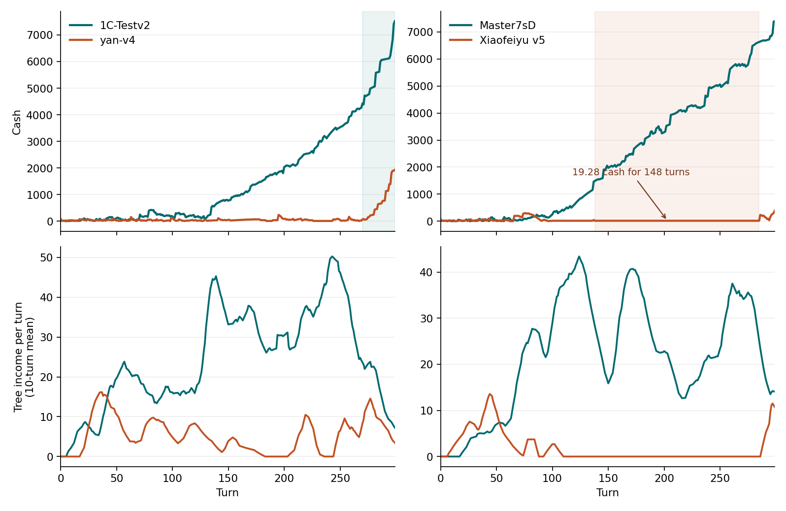

# 两局得分压制复盘

两局均按截图资金、回合和出生位与官方记录匹配。现金是已入账资金。在途碳和未到账的树收入分开核对。[yan-v4 对 1C-Testv2 的官方逐步摘要](https://117.72.210.134/api/summary/0024bb667d204c1754568de71eb16170/1) · [Master7sD 对小肥鱼的官方逐步摘要](https://117.72.210.134/api/summary/9b1c90aa0357d7d62aa0095d6523219d/1)

## yan-v4 对 1C-Testv2

第 101–250 步共 150 步。把“前压”定义为至少一名携带少于 30 碳的采集员，处在离对方任意基地两格以内。

| 指标 | yan-v4 | 1C-Testv2 |
| --- | ---: | ---: |
| 有轻载采集员前压的步数 | 2 | 141 |
| 树实际入账 | 503.76 | 4978.24 |
| 基地实际入账 | 620.06 | 1566.72 |
| 新种树 / 抢到树 | 4 / 7 | 30 / 4 |
| 招募 / 工人死亡 | 30 / 30 | 37 / 36 |

yan-v4 在这段时间死亡的 30 个工人里有 17 名采集员、13 名种植员，全部死于碰撞，死亡事件记录的携碳均为零。其中 14 次死亡在己方基地两格以内。1C 的倒下人数更多，但它用 30 次新种树建立了持续收入。单看击杀数或抢树数都会错过这场分差的主要来源。

第 270 步，yan-v4 的现金为 71 左右。第 271–299 步，它向己方基地交回 1735.66，另获树收入 226.09；同时 1C 交回 2825.18，另获树收入 403.44。终局为 1933.22 对 7513.16。前压与树收入差同时出现，具体哪一步前压造成哪一棵树的收益差仍需反事实对战验证。[完整回放](https://github.com/JUZI1/carbon-league-replays/blob/e4f11fff07a7f4e2d267197a188ccbb93bad9ead/replays/0024bb667d204c1754568de71eb16170-1.json.gz)

## Master7sD 对小肥鱼

- 第 135 步，小肥鱼的采集员带 268.38 碳死于碰撞，已没有树提供被动收入。
- 第 137 步，Master7sD 的采集员向小肥鱼基地交了 30。小肥鱼第 138 步花 30 招了一名采集员，第 141 步这名空载采集员也死于碰撞。
- 第 141–285 步，小肥鱼只有一个种植员且没有树。它的现金从第 138 到 285 步连续 148 个盘面停在 19.28。首树与夺树各需 20，招采集员需 30。
- 第 286 步，Master7sD 一名带 238.746 碳的采集员从 85 号格向上走进小肥鱼的 70 号基地，资金记给小肥鱼，同一步它花 20 种下第一棵树。第 287 步又招出采集员。官方终局为 7389.78 对 389.76。[完整回放](https://github.com/JUZI1/carbon-league-replays/blob/05f255b32442e61c8967a761dc557aad613f4c28/replays/9b1c90aa0357d7d62aa0095d6523219d-1.json.gz)

## 在 v5 里怎么检验

经济候选按局面增加收碳、补员、抢关键树和拦截收入的走法。资金危险时，它评估下一笔树收入、采集员携碳、最短回程、路上威胁和招募门槛。双方的同一套估值按差值比较。把前压当成获取收益或阻断回款的手段，长期占着基地附近本身不加分。[候选实现](../../experiments/v5/cashflow.py) · [训练与验证](../../experiments/v5/cashflow-validation.json) · [逐阶段可复核数据](observations.json)

复原三个关键回合时，先只给候选自己的可见碳量和公共棋子。候选交出动作后，再把它交给完整盘面的裁判，对方沿用当回合录像中的动作。原动作的双方资金、携碳、采集员和树数都与官方下一帧核对。第 134、140 步，整网重训版和新增经济候选都让实际会死的采集员活过了下一步。第 285 步，两个版本代替 Master7sD 行动时也都避免了给对手基地送碳。这个单步实验说明两个版本都看得见这三次机会，不能据此把改善归给新增模块，后续应看同图换边整局。[逐步动作和反事实结果](one-turn.json)
