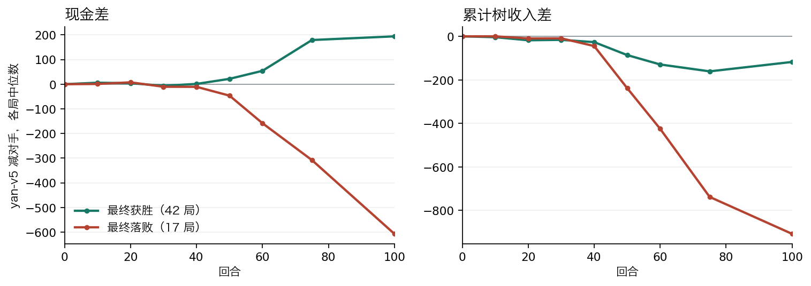

# 从 yan-v5 的线上对局开发 yan-v6

[公开回放快照](https://github.com/JUZI1/carbon-league-replays/tree/9213b31613d196b68e3f62a4138f4cb6fab32b0c)保留了同一策略 ID 的全部 59 局。读取榜单时，yan-v5 在重量榜第 7，42 胜 17 负。前两名 Apollo 和 Master7sE 各赢了它两次。对 1C-Testv2 三局全胜。57 局打满 299 步，和 Master7sE 的两局由裁判提前结束。[策略 ID、排行榜快照和对局文件清单](online-source.json)

## 开局从哪里分化

第 30 步，胜局和败局的现金差中位数都在 11 分以内。到第 75 步，胜局现金差为 +179，败局为 −308。败局组此时累计树收入差为 −738，基地累计入款差仍为 +29。按每场统计，败局里己方和对手累计新种树的中位数分别为 5 棵和 10 棵，首树中位时间反而比胜局早一步。六个同时有过胜负的对手中，有五个也出现败局树收入差更大的情况。[逐场复盘及例外](../../analysis/v6-online.json)



训练完成后，榜单又记入两场对 CarbonEdge_Artemis 的败局，战绩变为 42 胜 19 负，重量榜仍第 7。其中一局到终盘，yan-v5 的累计树收入多 805.80，基地累计入款少 818.05，最终落后 625.89。另一局则在第 70 步少 10 棵树、现金落后 646.51，最终落后 2569.85。两场未用于调参。[新增两局的分阶段记录及来源](../../analysis/v6-later-online.json)

## 提前出局的两场

第 109 步和第 191 步，yan-v5 分别只剩约 11 和 24 现金，失掉最后一名工人，场上也没有己方的树。两局最后记录的动作均为向下。锁定对手当回合实际走法，用原版裁判逐一枚举己方工人的五种动作，两局分别有三种和两种走法能让工人活过该回合。[逐项裁判结果](../../analysis/v6-elimination.json)

新规则只在己方没树、只剩一名工人且无法招募时生效。如果原定落点可能让工人死亡，同时存在对方任何一步移动或招募都无法致死的落点，就从安全动作中按行动模型重新选择。59 局共 17,343 个决策，其中 53 个决策满足经济条件。以线上记录动作为输入、用中性分数打破安全动作之间的平局，只需要改 3 步。两次避开当回合淘汰，另一次两种走法都能活下来。之后的真实对局走向未知。[逐步反事实复核](../../analysis/v6-guard.json)

## 开发图换边对战

同两张图上，learned 对 v5 为 4 胜 0 负，场均 +434.40。response 为 3 胜 1 负、+259.32，reserve 为 2 胜 2 负、+197.06，opponent 为 2 胜 2 负、−203.57，initiative 为 1 胜 3 负、−230.22。20 场均正常结束。按预先约定的顺序选 learned，再加入最后工人的保护规则并冻结文件。[全部开发局](../../analysis/arena)

第一个冻结文件在另三张预留图上为 **2 胜 4 负**，平均分差 +52.86，0 号位 2 胜 1 负，1 号位三场全负。六场均正常结束，双方均未出现超过一秒的决策。[首版文件存档](https://github.com/Zhaoyi-Yan/carbon/blob/7260fac/yan-v6.py) · [六场原始记录](../../analysis/arena/v6-confirmation.jsonl)

第二份候选在 learned 的基础上按角色校准对手动作概率。针对相同一组模拟对手应对，它比较每项备选行动相对原行动的收益；若一种行动收益很高但换个应对就容易大亏，搜索会调低其分数。领先时扣分较多，落后时会多承担一些风险。另取四张未使用的地图，每张交换出生位。[源码生成器](build_contested.py) · [冻结哈希与判定规则](contested-panel.json)

第二份候选在四张新图八局中 3 胜 5 负，场均 -424.28。采用相同应对来比较收益的机制未在这批地图取得胜势。[八场原始记录](../../analysis/arena/v6-confirmation-contested.jsonl)

## 候选实现

所有开发对手都是 [4be0055 的冻结 yan-v5](https://github.com/Zhaoyi-Yan/carbon/blob/4be00554b828ed12d98d33a3c1c98f60c9cf7780/yan-v5.py)。[地图种子和选择规则](panel.json)区分开发和最终复测，均交换出生位。全部策略使用比赛时间预算，逐局 JSONL 同时记录每个座位的文件哈希、实际耗时、搜索次数以及结算状态。

- initiative 根据己方可见的碳量，对空地的种树机会、可夺树的剩余收益和附近护送单位进行估计，给原搜索增加一组行动。
- reserve 在 initiative 上加入短期资金预测，给低现金且补给不足的局面扣分。推演发生提前淘汰时按官方裁判计分。资金模型使用 300 张历史训练地图和 39 场 yan-v5 线上训练对局。在线独立保留 20 场检验，未来 44 步分差变化的平均绝对误差为 243.87，保持当前分差的预测误差为 306.05。[训练、验证地图及各预测期结果](projection.json)
- learned 用原有风格网络提取特征，在历史回放和实际击败 yan-v5 的对手动作上单独微调工人及基地行动头。[动作训练与复现](learned.md)

- opponent 根据可观测的敌方落点分别校准采集员和种植员动作的概率，更新根节点和后续搜索。六场线上回放中，对方工人实际走法的平均预测对数损失从 0.615 降到 0.459。[离线逐局复核](../../analysis/v6-opponent-audit.jsonl)
- response 基于 learned，只在第 22–94 步树数和近期收入同时落后时提出额外争树选择。若现金不足招募且树收入低，搜索会额外考虑重载采集员到不同基地的路径以及轻载采集员接应的可能性。

从仓库的本地竞技场环境运行以下命令。SNAPSHOT 包含固定版本的 index.json 和 replays/。绝对路径或相对路径均可。

```sh
python experiments/v6/review.py --data "$SNAPSHOT"
python experiments/v6/elimination_audit.py "$SNAPSHOT" /tmp/v6-elimination.json
python experiments/v6/guard_audit.py "$SNAPSHOT" /tmp/v6-guard.json
python experiments/v6/build_initiative.py /tmp/initiative.py
python experiments/v6/build_reserve.py /tmp/reserve.py experiments/v6/projection.json
python experiments/v6/learn_export.py yan-v5.py experiments/v6/learned-heads.npz /tmp/learned.py
```
